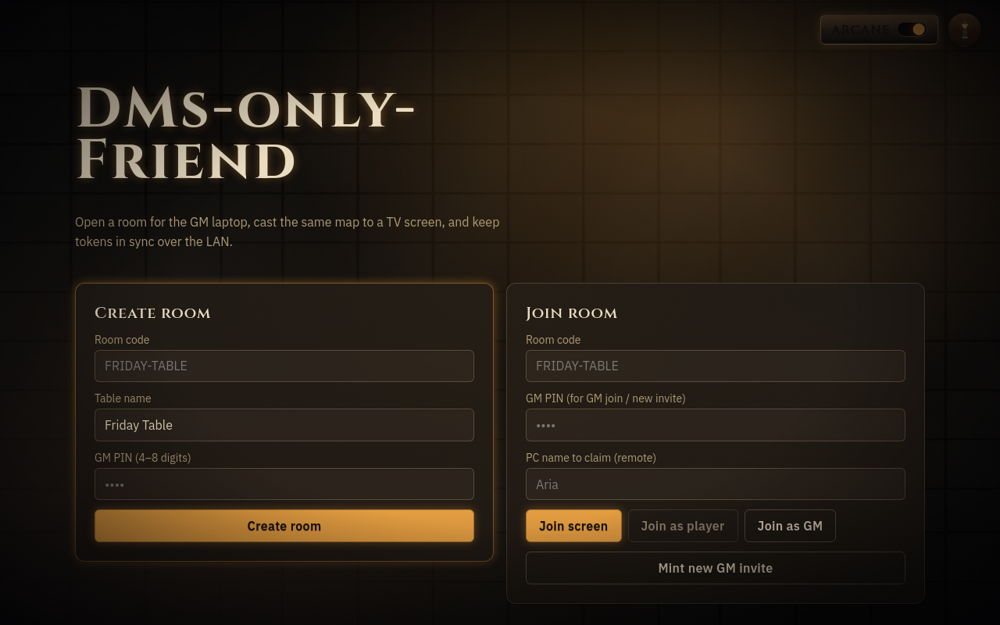
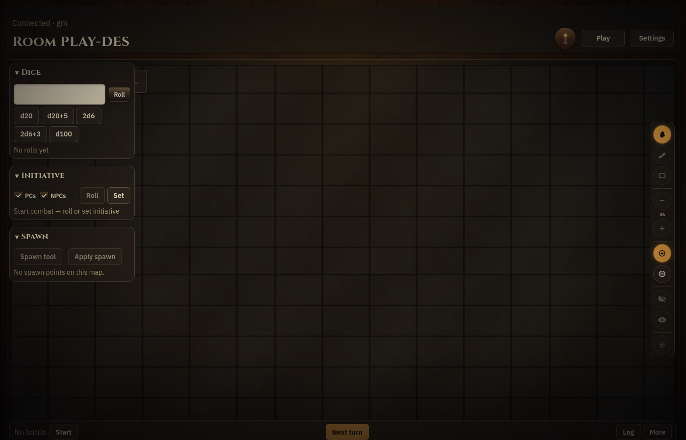
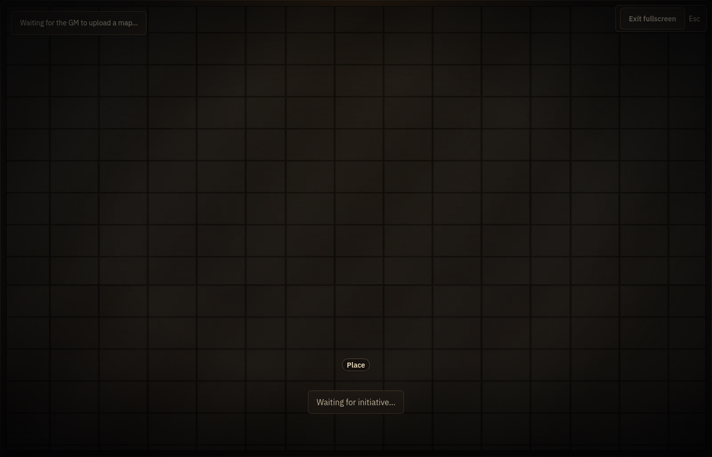
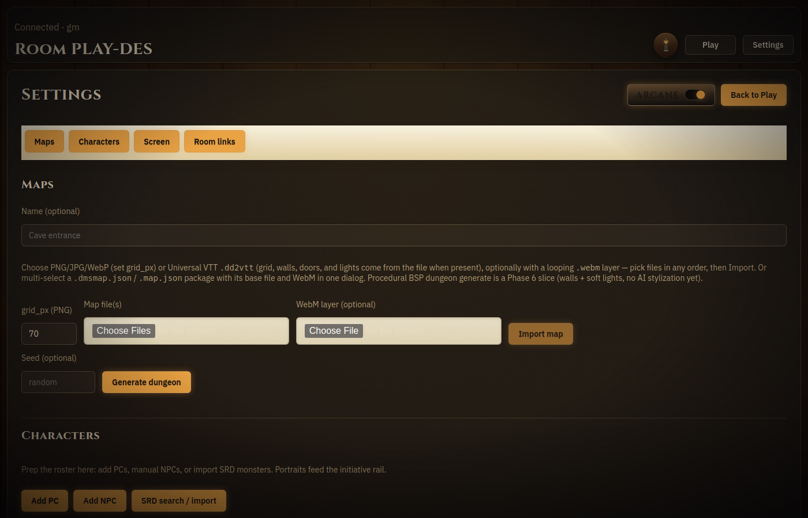

# DMs-only-Friend

Normally DMs have no friends. But this web app doesn't judge good throws.

**DMs-only-Friend** is a self-hostable web app for tabletop RPGs (D&D and others). It shows the battle map on a separate screen (TV/tablet as the table), stays in sync with the GM view, and helps the GM run the session: initiative, dice, fog of war, monster quick-stats.



## Features

| Area | What you get |
|---|---|
| **Table core** | Rooms with PIN + single-use GM invite; multi-map Settings + Play HUD; tokens; dice |
| **Combat** | Initiative carousel, HP / conditions, 0 HP leaves initiative with dead token look |
| **Fog & map** | Manual fog + LoS from walls; doors/portals; soft `.dd2vtt` lights; WebM map packages |
| **Screen** | Player/TV view with fan initiative carousel; camera follows the GM |
| **Prep** | Character roster, portraits, SRD 5.1 monster import (CC-BY-4.0), spawn placement |
| **Deploy** | Docker / GHCR image, default host port **8042** |

Themes: **Arcane** (dark, default) and **Tavern** (light), per device.





## Quick start (dev)

Requirements: **Node.js 20+**, npm.

```bash
npm install
npm run dev
```

- Client: http://localhost:5173  
- Server: http://localhost:3001  
- Test map: `fixtures/dungeon-map-for-testing.png`

```bash
npm run lint
npm run test
npm run build
```

## Quick start (Docker)

Full guide: **[docs/docker-setup.md](docs/docker-setup.md)** (compose, `PUBLIC_ORIGIN`, WebSocket reverse proxy). ADR: [0015](docs/decisions/0015-docker-ghcr-packaging.md).

```bash
cp .env.example .env   # set PUBLIC_ORIGIN
docker compose pull && docker compose up -d
```

- Image: `ghcr.io/firesh0ot/dms-only-friend`
- Default: host **8042** → container **3001**
- Data: named volume `dms-data` (SQLite + uploads)
- Behind a reverse proxy: set `PUBLIC_ORIGIN=https://your.fqdn` and enable WebSocket upgrades — otherwise join hangs on **Joining room…**

## Status

Phases 1–6 table slices are on main (rooms, maps, fog/LoS, physical screen calibration, spawn/movement budget, BSP generate). Phase 6 image stylization and Phase 7 MCP remain later.

Specs: [phase-1](docs/phase-1.md) · [phase-4](docs/phase-4-offline-screen.md) · [phase-5](docs/phase-5-online-movement.md) · [phase-6](docs/phase-6-procedural-dungeon.md) · [SRD library](docs/srd-monster-library.md) · [design rework](docs/design-rework.md)



## Documentation

- **Playing** — GM + remote players: [EN](docs/playing/en/README.md) · [DE](docs/playing/de/README.md)
- **Developing** — monorepo, Prep/Play architecture: [docs/developing/README.md](docs/developing/README.md)
- **Docker / table deploy** — [docs/docker-setup.md](docs/docker-setup.md)
- **Decisions** — [docs/decisions/README.md](docs/decisions/README.md)

Screenshots under `docs/screenshots/` are app UI captures (no third-party art).

## Roles

| Role | View |
|---|---|
| **GM** | Settings (maps, roster, links) + Play HUD (map, initiative, fog, spawn, dice) |
| **Player-Screen** | Map + fan initiative; camera follows GM |
| **Player (remote)** | Like screen + own token |

## Architecture (short)

- **Web app**: React + TypeScript, PixiJS v8 map canvas — no Electron
- **Backend**: Node.js + Socket.IO; server is single source of truth
- **Persistence**: SQLite + uploads on disk
- **Auth**: room codes (no accounts); GM needs PIN + one-time invite
- **Maps**: Universal VTT (`.dd2vtt`); PNG/JPG fallback; optional WebM layer
- **Roadmap leftovers**: Phase 6 stylization, Phase 7 MCP / sounds / macros — see [AGENTS.md](AGENTS.md)
